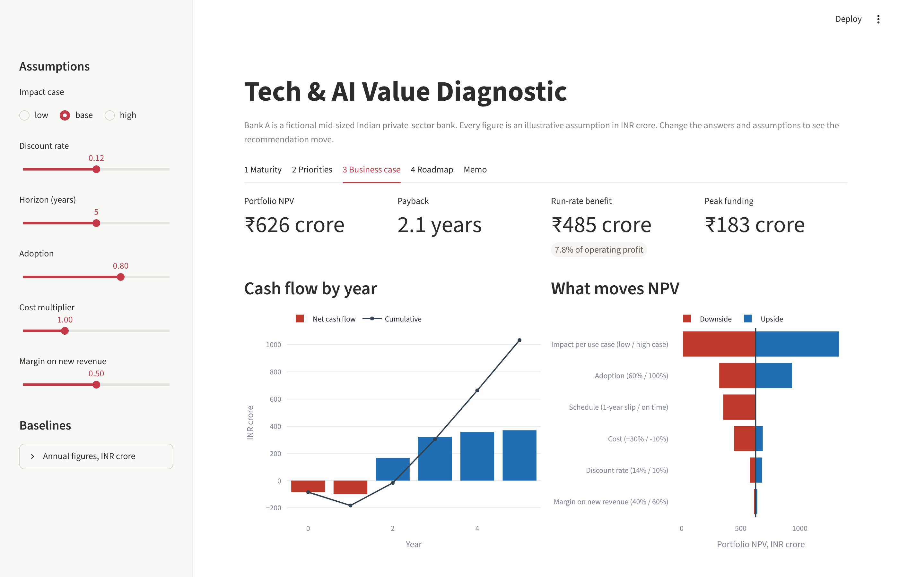
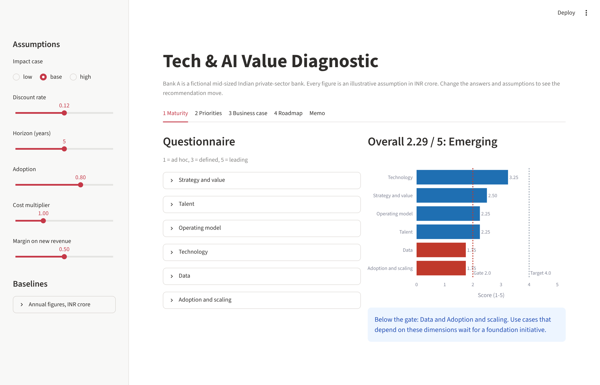
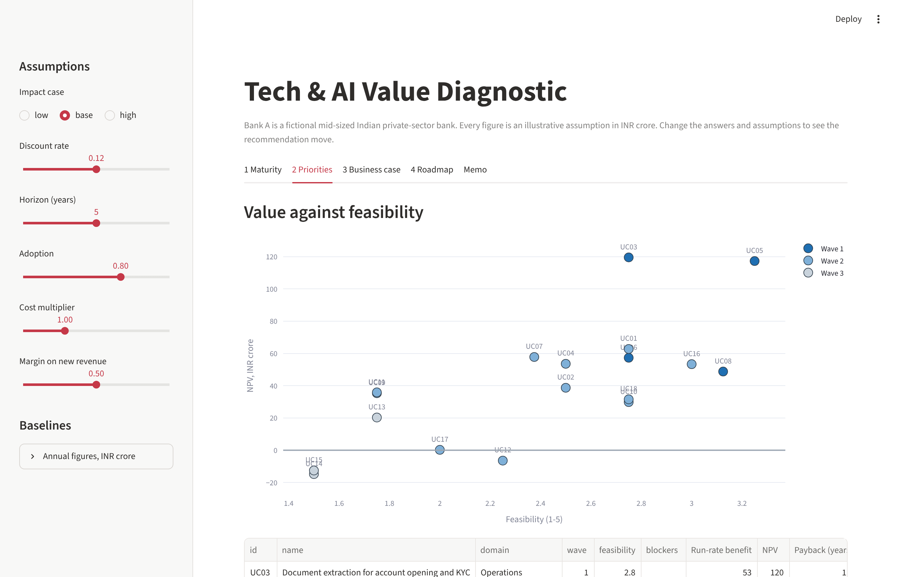

# Tech & AI Value Diagnostic

A working model of the question a bank's leadership asks about AI: **where does it pay, what has to be fixed first, and what is it worth?**

It takes a maturity questionnaire and a set of financial baselines, and produces a prioritized use-case portfolio, a business case with NPV and payback, a sequenced roadmap, and a written memo.



## What it finds for the sample bank

The worked example is **Bank A, a fictional mid-sized Indian private-sector bank**. Its figures are illustrative assumptions, not data about a real institution.

- Bank A scores 2.29 out of 5. Technology (3.25) is ahead of data (1.75) and adoption (1.75).
- Four technology-led use cases can start now and are worth ₹343 crore in NPV.
- Fourteen of eighteen use cases wait on the data or adoption foundations.
- The full programme has an NPV of ₹626 crore over five years and pays back in 2.1 years.
- Three use cases do not pay back within five years and should be held.
- The answer is most sensitive to realized impact and adoption, and least to build cost.

The full argument is in [docs/memo.md](docs/memo.md). It is generated from the model, and a test fails if the two disagree.

## How it works

| Step | Module | What it does |
|---|---|---|
| 1. Maturity | `src/prime/diagnostic.py` | Scores six dimensions from 24 questions; flags any dimension below the gate |
| 2. Priorities | `src/prime/prioritize.py` | Rates feasibility from the dimensions each use case depends on; assigns a wave |
| 3. Business case | `src/prime/business_case.py` | Cash flows, NPV, payback, and a one-at-a-time sensitivity table |
| 4. Roadmap | `src/prime/roadmap.py` | Foundation initiatives, then use cases by wave, each with a success measure |
| Memo | `src/prime/narrative.py` | Writes the memo from the model's tables |

Scoring rules, formulas, assumptions and limits are in [docs/methodology.md](docs/methodology.md). Inputs are plain files in `data/`: edit them to model a different bank.




## Run it

Requires Python 3.11 or later.

```bash
pip install -e ".[dev]"
pytest                      # 16 tests
streamlit run app.py        # opens the app; no API key needed
python -m prime.narrative   # prints the memo
```

To host it, push the repo to GitHub and deploy `app.py` on Streamlit Community Cloud (share.streamlit.io) from your own account.

## How AI is used

All scoring and finance is ordinary Python, so the numbers are reproducible and testable. A language model has one optional job: rewording the memo's opening paragraph (`python -m prime.narrative --llm`, needs `pip install -e ".[llm]"` and Anthropic credentials). Its output is discarded if it contains any number that is not in the draft. The repository was built with an AI coding assistant; the design choices, assumptions and review are mine. Details are in the methodology.

## Limits

- Bank A's baselines, questionnaire answers and the impact range of each use case are assumptions. They show how the model behaves; they are not benchmarks.
- No peer comparison is included. Bank-level cost and technology data is published by the RBI and in annual reports, and [data/SOURCES.md](data/SOURCES.md) says where to get it.
- Cash flows are pre-tax, and each use case is valued independently of the others.
