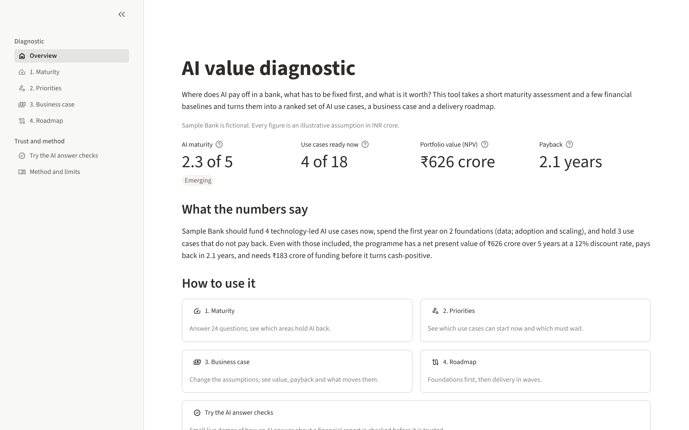
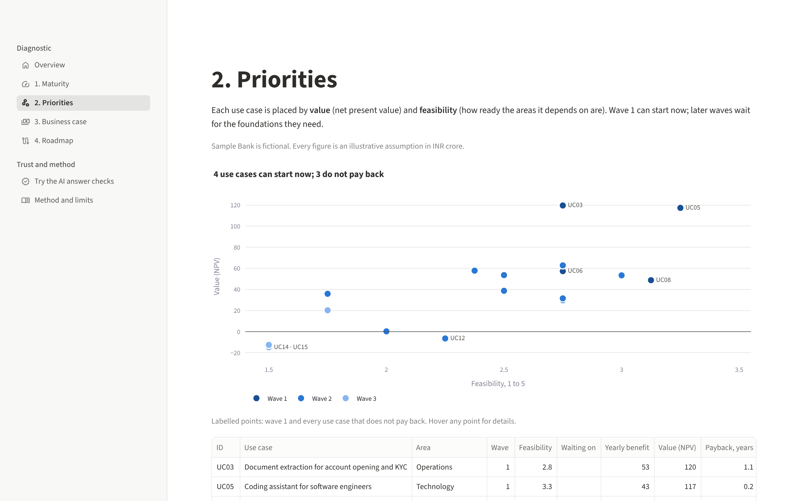
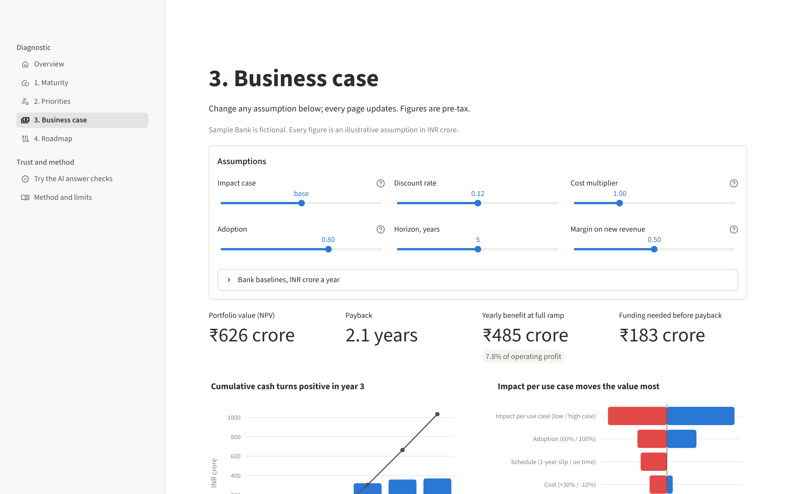
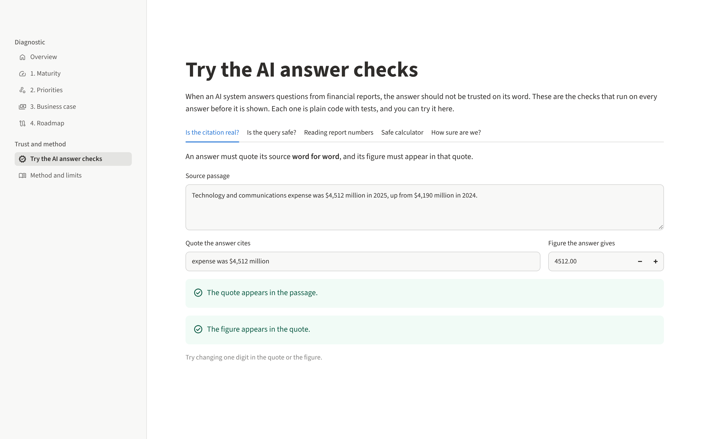

# AI Value Diagnostic for Banks

An interactive tool that estimates where AI creates value in a bank: it scores AI maturity, ranks AI use cases by value and feasibility, builds the business case (NPV, payback, sensitivity) and lays out a delivery roadmap. It also includes small, tested checks that decide whether an AI-generated answer about a financial report can be trusted.



**Try it:** run it locally in two commands ([below](#how-do-i-run-it)). The examples use a fictional bank; every figure is an illustrative assumption.

## What does it do?

1. **Maturity assessment.** Twenty-four questions across six areas (strategy, talent, operating model, technology, data, adoption) give a score from 1 to 5 and show which areas hold AI back.
2. **Use-case prioritisation.** Eighteen banking AI use cases, from KYC document extraction to fraud scoring and relationship-manager assistants, are placed by value and feasibility and grouped into delivery waves.
3. **Business case.** Cash flows, net present value and payback for the portfolio, with a sensitivity chart showing which assumptions matter most.
4. **Roadmap.** Foundation work first, then use cases by wave, each with a milestone and a success measure.

Every input can be changed in the app, and every page updates.

## Who is it for?

- **Strategy and transformation teams** who need a first, structured view of AI opportunities and their economics.
- **Analysts** who want a transparent model they can inspect and adapt, rather than a black box.
- **People building AI assistants for finance** who want simple, testable rules for when an answer can be trusted.

## What does the example show?

For the fictional Sample Bank, a mid-sized private-sector bank:

- Technology is the strongest area (3.25 of 5); data and adoption fall below the threshold (1.75 each).
- Four technology-led use cases can start now; fourteen wait on data or adoption foundations.
- The full programme is worth ₹626 crore in net present value over five years and pays back in 2.1 years.
- Three use cases do not pay back within five years and are marked to hold.
- The result depends most on how much impact each use case delivers and how widely it is adopted; build cost matters far less.



## How does it work?

| Step | In plain terms |
|---|---|
| Score maturity | Average the answers for each area; flag any area below 2 out of 5 |
| Rank use cases | Rate each one by how ready the two areas it depends on are, adjusted for complexity |
| Value them | Yearly benefit = baseline cost or revenue × expected impact × adoption, ramped up over time, minus build and running costs |
| Sequence them | Use cases blocked by a weak area wait for the foundation work that fixes it |

The full formulas, assumptions and limits are in [Method and limits](docs/method.md), which is also a page in the app.



## How are AI answers checked before they are trusted?

When an AI system answers a question from a financial report, it should show its source and its figure should be traceable. The app has a page where you can try each check:

- **Is the citation real?** The quoted text must appear word for word in the source, and the figure must appear in the quote.
- **Is the database query safe?** The AI may only read, from approved tables, with a row limit. Deleting data or reading files is refused.
- **Is the number read correctly?** Brackets, dashes and table scales such as thousand, lakh, million and crore are handled explicitly.
- **How sure are we?** Test accuracy is shown with a confidence interval, so a small test is not mistaken for a precise one.



## How do I run it?

With [uv](https://docs.astral.sh/uv/):

```bash
uv sync
uv run streamlit run app.py
```

Or with pip: `pip install -e .` then `streamlit run app.py`. No API key or internet access is needed.

To run the tests, linting and type checks: `make check`.

## What is in progress?

A filings analysis assistant that answers questions about banks' technology and AI spending from their published annual reports, cites the exact passages it used, and declines when the reports do not say. It will come with an evaluation that measures how often answers are right, what they cost and where they fail. The checks above are its first tested parts; there are no results to report yet.

## What are the limits?

- The sample bank and the impact of each use case are assumptions, not benchmarks.
- Use cases are valued one at a time, so overlaps between them are not netted off.
- Figures are pre-tax and there is no comparison with peer banks yet.

## Frequently asked questions

**Is the data real?**
No. Sample Bank is fictional and its figures are round numbers chosen to illustrate how the model behaves.

**Can I use my own numbers?**
Yes. Change the answers and assumptions in the app, or edit the files in `data/` (questionnaire, bank baselines, use-case library).

**Does it need an AI model or an API key?**
No. All scoring and financial calculations are ordinary Python and run offline.

**Where do the impact estimates come from?**
They are stated as low, base and high cases for each use case. The sensitivity chart shows they are the largest source of uncertainty, so they are the first thing to replace with measured pilot results.

**Can it be used outside banking?**
The method is general. The use-case library and baselines are written for a bank, so another sector needs its own versions of those two files.

**How was it built?**
In Python with pandas, Plotly and Streamlit, with tests for the financial formulas and each check. An AI coding assistant was used to write code and first drafts; the design, assumptions and review are the author's.

## Built with

Python · pandas · NumPy · Plotly · Streamlit · Pydantic · sqlglot · pytest · Ruff · mypy

## Licence

[MIT](LICENSE)
